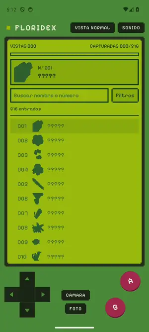
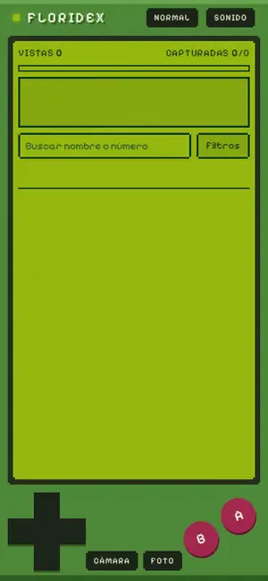
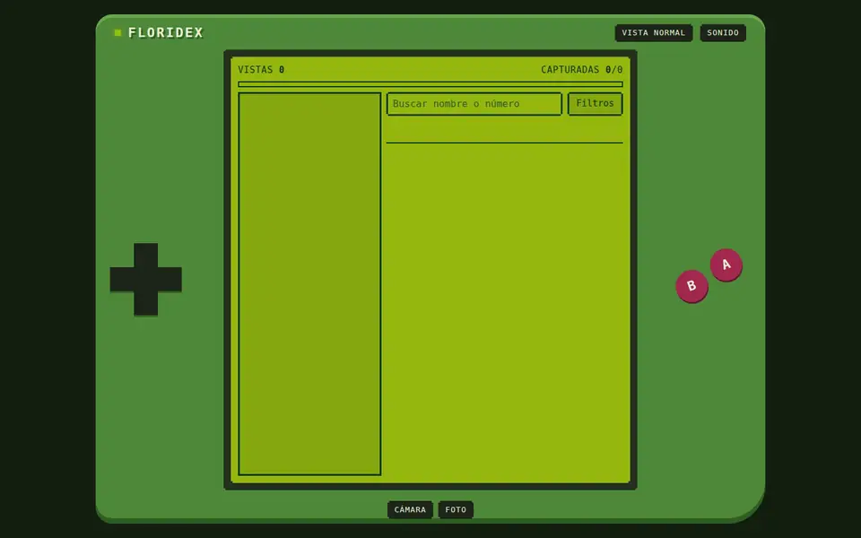

# Floridex

A pocket flower index you fill by photographing flowers. Point the camera at a flower and Floridex names it among 516 species, registers it with its number and opens its card in Spanish: names, family, description, habitat, flowering, care, symbolism, etymology, uses and toxicity. Everything runs on the device; photos and progress never leave it.

| Android | Web on a phone |
|:---:|:---:|
|  |  |



Real recordings at their own speed (idle pauses shortened): an Android emulator picking a photo, and Chromium at phone and desktop size filming a flower with its camera.

## Try it

- **Android 8 or later:** download the APK for your phone (almost always `arm64-v8a`) from the [latest release](https://github.com/iDiagoValeta/floridex/releases/latest) and open it. Android asks once to allow installing from your browser or file manager.
- **iPhone and any browser:** build the web app (`cd web && pnpm install && pnpm build`) and serve `web/dist` from any static host over https. Open it once online and it keeps working offline; add it to the home screen to use it like an app.

## What it does

- **An index to complete.** Every flower the model knows has a numbered entry. It starts unseen (a pixel silhouette), becomes seen when the model offers it as a candidate and is captured when your photo identifies it. Search by name or number, filter by state, family, garden or wild, season and colour.
- **Honest answers.** The confidence shown is calibrated: when the model is below 70 % sure it does not guess, it asks you to pick among its three best candidates, each with a reference photo. Photos without a flower are recognised as such.
- **A 90s pocket device.** Four-green LCD screen, a pad, A and B buttons, 8-bit sounds made on the fly and a text box that types itself out. A «Vista» switch shows photos as they are or pixelated like a pocket camera.
- **Camera, gallery and share.** Live camera on phone or desktop, photo upload, and on Android «Identificar con Floridex» from any app's share menu.
- **Private and offline.** The model (25 MB, int8 ONNX) runs in the browser through WebAssembly or on the phone through ONNX Runtime. No account, no server, no analytics.

## The model

DINOv2-small fine-tuned on six public datasets plus Creative Commons photos from iNaturalist, merged into one taxonomy of 516 flowers and a "no flower" class, temperature-calibrated and quantized to int8. Accuracy of the shipped int8 model on held-out test photos, measured 2026-11-21:

| Benchmark | Classes | Test photos | Accuracy |
|---|---:|---:|---:|
| iNaturalist 2021, flowering plants subset | 75 | 11883 | 95.1 % |
| Pl@ntNet-300K, flower photos | 296 | 17231 | 85.2 % |
| Oxford 102 Flowers | 102 | 6149 | 98.8 % |
| Oxford 17 Flowers | 17 | 272 | 98.9 % |
| tf_flowers | 5 | 734 | 97.5 % |
| Swedish Flowers | 88 | 1336 | 97.0 % |
| Photos without a flower, rejected | 1 | 4522 | 99.4 % |
| Garden photos from iNaturalist, never seen in training | 80 | 3301 | 94.9 % |

Accuracy follows each dataset's protocol (the answer restricted to that dataset's classes); the garden benchmark answers over all 517 classes. Train photos that are near duplicates of a test photo are removed before training. The web and Android apps prepare each photo exactly as in training and are checked against the Python predictions on the same photos.

## How it is built

```
ml/        training, calibration, export and evaluation (PyTorch, transformers, ONNX)
shared/    the shipped model, the 516 cards, reference photos, sprites and their credits
web/       Vite + TypeScript + transformers.js, a PWA that works offline
android/   Kotlin + Jetpack Compose + CameraX + ONNX Runtime
```

`shared/` holds the only copy of the model and the app data; both apps copy it in at build time. Building, testing and retraining are described in [docs/development.md](docs/development.md); how to contribute, in [CONTRIBUTING.md](CONTRIBUTING.md).

## Credits and licences

- Code: [Apache License 2.0](LICENSE).
- Reference photos: 514 photos from [iNaturalist](https://www.inaturalist.org) under CC0, CC BY or CC BY-SA, each credited on its card with a link to the observation ([`shared/miniaturas2/creditos.json`](shared/miniaturas2/creditos.json)). The pixel sprites in `shared/sprites/` are adaptations of those photos under the same licence as their source.
- The demo films [a sunflower](https://www.inaturalist.org/observations/7300021) by Adam J. Searcy (CC BY) and picks [a dandelion](https://www.inaturalist.org/observations/156701280) by Gavin Slater (CC BY).
- Training data, not redistributed here: Oxford Flowers 102 and 17 (Visual Geometry Group, University of Oxford), tf_flowers (TensorFlow team), Swedish Flowers, iNaturalist 2021, Pl@ntNet-300K, Imagenette, Caltech-101 and SUN397.
- Base model: [DINOv2](https://github.com/facebookresearch/dinov2) (Meta AI, Apache 2.0).
- Font: Pixelify Sans (SIL Open Font License).
